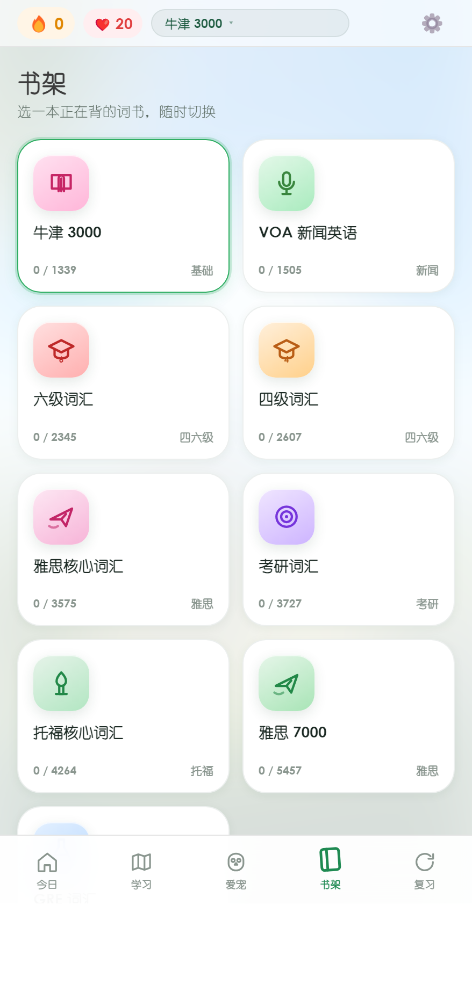
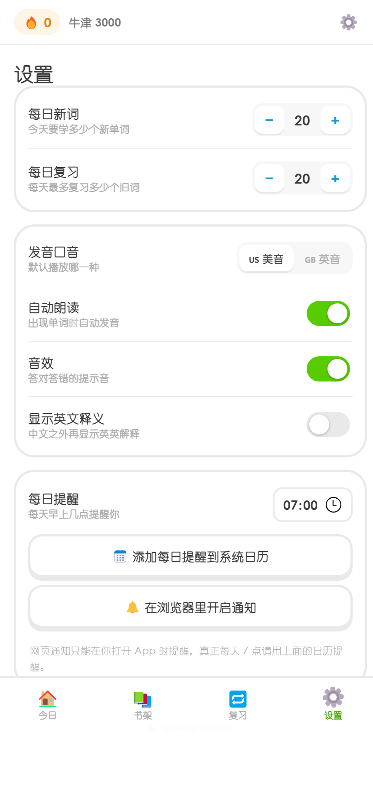

# 小越背单词

一个装到手机桌面就能用的背单词 App：每天定时提醒、按遗忘曲线复习、可以自己挑词书、英音美音都能读。

- **手机优先**，装到桌面后像原生 App（PWA）
- **完全离线可用**：词库和代码都在本地，断网照样背
- **9 本词书**：雅思核心 / 雅思 7000 / 托福 / 考研 / 四六级 / GRE / 牛津 3000 / VOA
- **错词复习**：答错的词自动回到队列，按 1/2/4/7/15/30/60 天排期
- **数量自己定**：每天几个新词、几个复习，随时改
- **例句带中文翻译**，单词一键朗读美音/英音
- **多邻国式动效**：原创吉祥物（会眨眼、答对跳、答错摇头）、连击火焰、进度环、撒花、音效
- **爱心机制**：每天 20 颗 ❤️，答错扣 1 颗，用完当天就收工（次日 0 点自动恢复）
- **等级与经验**：答对 +10 XP、模糊 +5，升级曲线 100 → 135 → 182 …，首页显示 Lv. 和经验条
- **环游世界学习路径**：词书按 20 词一关切成蜿蜒路径，每 10 关换一个国家的风景（中国→日本→…→南极），单词卡背景也跟着变成当地景色
- **3D 卡通界面 + 昼夜双主题**：首页有天空/太阳/云/山丘的场景头图；白天是蓝天绿丘，夜晚是星空月牙。设置里可选「自动（跟随系统）/ 白天 / 夜晚」

| 白天 | 夜晚 |
|---|---|
|  |  |

| 今日 | 学习卡片 |
|---|---|
|  |  |
| **书架** | **设置** |
|  |  |

### 环游世界学习路径


一关 20 个词，顺着弯曲的小路往下走；每 10 关进入下一个国家，走过的地方会变成打勾的绿色节点。

---

## 三分钟发给朋友（拖一下就上线）

不用装 git、不用注册服务器：

1. 打开 <https://app.netlify.com/drop>
2. 把工作目录里的 `小越背单词-部署包.zip` 拖进去（或者解压后拖整个文件夹）
3. 立刻得到一个 `https://xxx.netlify.app` 链接 —— 直接发给朋友

朋友在 iPhone 上打开 → 分享 → 添加到主屏幕，就是一个**属于他自己**的 App：进度存在他自己手机里，和你互不影响，他看不到你的数据。

> ⚠️ Netlify 未登录的 Drop 站点是临时的。**注册一个免费账号，在站点页面点 Claim site**，链接才会永久保留。

---

## 一、最快上手（本机看效果）

双击 `start.cmd`，浏览器会打开 `http://127.0.0.1:8765/`。

> 如果你的电脑上没有 Python 也没有 Node，`start.cmd` 会提示你。也可以直接跳到第二节部署上线，用手机打开。

---

## 二、部署到线上（手机要用的必做这一步）

手机要能打开，必须有一个 `https://` 地址。用 GitHub Pages 免费、够快、不用买服务器。

1. 在 GitHub 新建一个**私有或公开**仓库，名字随意，例如 `vocab-shelf`
2. 把本目录所有文件推上去：

   ```powershell
   cd <本目录>
   git init
   git add .
   git commit -m "feat: 小越背单词"
   git branch -M main
   git remote add origin https://github.com/<你的用户名>/vocab-shelf.git
   git push -u origin main
   ```

3. 仓库页 → **Settings → Pages** → Source 选 `Deploy from a branch` → 分支 `main`、目录 `/ (root)` → Save
4. 等 1 分钟，访问 `https://<你的用户名>.github.io/vocab-shelf/`

> 国内访问 GitHub Pages 有时慢。备选：Gitee Pages（需实名）或 Cloudflare Pages（绑定 GitHub 仓库，自动部署）。

---

## 三、装到手机桌面（关键一步）

1. 用手机浏览器打开上面的网址
2. **iPhone（Safari）**：点底部「分享」→「添加到主屏幕」
3. **安卓（Chrome / Edge）**：右上角菜单 →「安装应用」或「添加到主屏幕」

装好以后图标就在桌面上，点开全屏运行，和 App 一样。

---

## 四、每天 7 点提醒

网页本身无法在后台定时弹通知，所以用系统日历——这是唯一 100% 准时且免费的办法。

1. App 内进入 **设置 → 每日提醒**，把时间设成 `07:00`
2. 点 **「添加每日提醒到系统日历」**，会下载一个 `.ics` 文件
3. 用手机打开这个文件，选择「添加到日历」

之后每天 7 点系统日历会提醒你。日历里可以改成你喜欢的铃声，也可以设置重复到你完成的那天。

> 另外「在浏览器里开启通知」也做了，但它只在 App 打开时有效，当个补充就行。

---

## 五、每日新闻怎么来的

`data/news.json` 由 GitHub Actions 每天 **06:30（北京时间）** 自动抓取，赶在 7 点提醒前更新。

- 工作流文件：`.github/workflows/daily.yml`
- 抓取脚本：`scripts/fetch_news.py`（只用标准库，无依赖）
- 新闻源：BBC Learning English / VOA Learning English / BBC World / The Guardian / NPR / China Daily，按顺序取第一个能通的

想改新闻源，直接编辑 `scripts/fetch_news.py` 里的 `FEEDS` 列表。

> 抓取失败不会报错，只会保留上一天的新闻，不影响背单词。

---

## 六、目录结构

```
ielts-bookshelf/
├── index.html                 # 界面
├── css/app.css                # 基础样式与动效
├── css/cute.css               # 可爱化皮肤（吉祥物、圆角、3D 按钮）
├── js/app.js                  # 全部逻辑（SRS、发音、会话、设置）
├── sw.js                      # Service Worker（离线缓存）
├── manifest.webmanifest       # PWA 配置
├── start.cmd                  # 本机一键预览
├── data/
│   ├── books/index.json       # 书架元数据
│   ├── books/*.json           # 每本词书（按需加载）
│   └── news.json              # 每日新闻
├── icons/                     # 应用图标
├── scripts/
│   ├── build_books.py         # 把开源词表构建成 data/books/*
│   ├── fetch_news.py          # 抓新闻
│   └── make_icons.py          # 生成图标
└── .github/workflows/daily.yml
```

---

## 七、想加一本自己的词书

1. 在 `scripts/build_books.py` 的 `BOOKS` 列表里加一行：

   ```python
   ("mybook", "MyDict.json", "我的词书", "说明文字", "分类"),
   ```

2. 把词表 JSON 放进 `%TEMP%\dict-src\`（格式：`[{"name":"word","trans":["释义"],"usphone":"...","ukphone":"..."}]`）
3. 运行 `python scripts/build_books.py`

也可以直接把词表按同样格式写成 `data/books/mybook.json`，再往 `data/books/index.json` 里加一条记录。

---

## 八、数据与隐私

- 所有学习进度只存在**你这台设备的浏览器里**（`localStorage`），不上传、不联网
- 换设备不会自动同步。想搬家：**设置 → 导出学习进度**，在新设备上**导入**
- 清空浏览器数据会丢进度，建议每周导出一次备份

---

## 九、词库与例句来源

- 词表：[RealKai42/qwerty-learner](https://github.com/RealKai42/qwerty-learner)（MIT）
- 双语例句：[ManyThings / Tatoeba](https://www.manythings.org/anki/)（CC-BY）
- 英文例句补充：4000 Essential English Words（同仓库）

例句覆盖率：雅思核心 58%、雅思7000 41%、托福 52%、考研 70%、六级 67%、四级 80%、GRE 23%、牛津3000 92%、VOA 95%。没有例句的词会显示「暂无例句」，不会编造。
