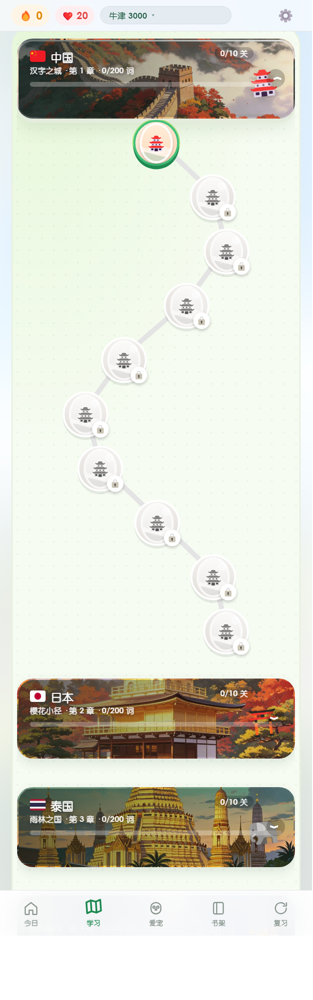
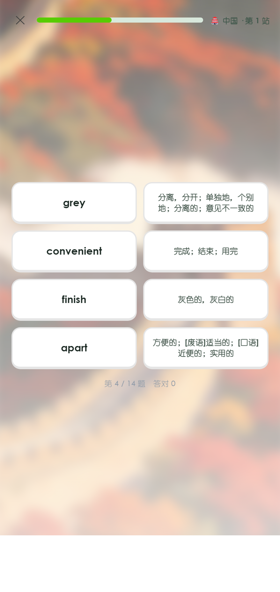
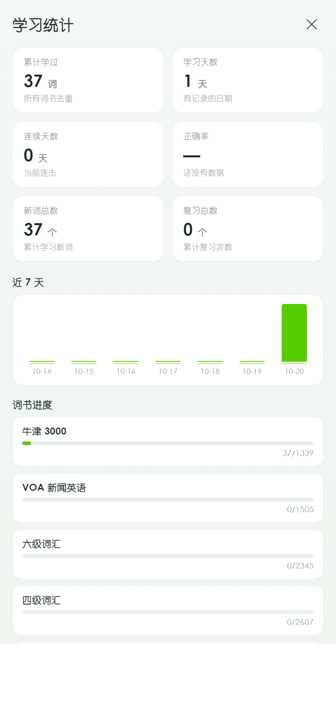

# 小越背单词

[](https://github.com/suzy553/dictionaryusers/actions/workflows/ci.yml)

> 一个装到手机桌面就能用的背单词 PWA：间隔重复算法 + 环游世界闯关 + 完全离线可用。

**纯静态 · 零依赖 · 零构建 · 词库打包在本地**

---

## 在线体验

🔗 **https://suzy553.github.io/dictionaryusers/**

> 手机浏览器打开 → 分享 → 添加到主屏幕，即可当原生 App 使用。
> 首次打开约 3 秒（下载约 7MB 资源），之后完全离线。

---

## 界面

| 首页 | 学习路径 | 闯关：看词选义 |
|---|---|---|
|  |  |  |

| 闯关：听写 | 闯关：词义配对 | 学习统计 |
|---|---|---|
|  |  |  |

---

## 核心功能

### 1. 间隔重复（SRS）

采用 **Leitner Box** 算法，每个词有 0~7 的记忆等级：

| 等级 | 0 | 1 | 2 | 3 | 4 | 5 | 6 | 7 |
|---|---|---|---|---|---|---|---|---|
| 下次复习 | 今天 | 1 天 | 2 天 | 4 天 | 7 天 | 15 天 | 30 天 | 60 天 |

- **答对** → 等级 +1，复习间隔推后
- **答错** → 等级归零，明天重来
- 每天进入时自动算出「到期复习 + 新词」的混合队列

### 2. 环游世界学习路径

词书按 **20 词一关** 切成蜿蜒路径，每 **10 关换一个国家**，共 30 国：

```
中国 → 日本 → 韩国 → 泰国 → … → 埃及 → 希腊 → 意大利 → … → 南极
```

每关有国家风景背景、地名卡、第 N 站进度点。

### 3. 闯关模式（8 种题型，100% 程序化生成）

| 题型 | 维度 | 生成方式 |
|---|---|---|
| 看词选义 | 读 | 正确释义 + 同词书随机 3 个干扰释义 |
| 看中文选英文 | 读 | 反向：给中文选英文单词 |
| 例句填空 | 读+写 | 取含该词的例句，把目标词挖空 |
| 判断正误 | 读 | 50% 概率配一个错误释义 |
| 听音选词 | 听 | 在线音频 + 4 个长度相近的词 |
| 听写 | 听+写 | 字母打乱 + 4 个干扰字母，点选拼词（不弹键盘） |
| 句子排序 | 写 | 例句词序打乱，按正确顺序点回 |
| 词义配对 | 读 | 4 词 ↔ 4 释义，两两配对 |

**设计要点**

- 题型**随机混排**，不先刷词再做题（避免用户无脑点「认识」）
- 数据不足时**自动降级**（例：无例句 → 不出填空题，改出选择题）
- 通关线 = 答对 70%，**答错不扣分**
- 通关奖励：+40 XP、+3 爱心；重复通关减半

### 4. PWA 离线

- Service Worker 预缓存全部代码与素材
- **代码类资源「网络优先」**（改完刷新即生效），**图片素材「缓存优先」**（省流量）
- 断网可继续背单词，只有发音需要联网

---

## 技术实现

### 技术栈

```
原生 JavaScript（无框架）+ 原生 CSS + Service Worker
零 npm 依赖、零构建步骤、无后端
```

**为什么不用框架？** 项目目标是「低端手机秒开 + 完全离线」。React/Vue 的运行时体积和构建产物反而是负担。4200 行原生 JS 换来的是**首屏 0 依赖、任何静态服务器都能直接跑**。

### 目录结构

```
ielts-bookshelf/
├── index.html              单页入口
├── sw.js                   Service Worker（离线缓存）
├── manifest.webmanifest    PWA 清单
├── css/
│   ├── app.css             主样式
│   ├── path.css            学习路径样式
│   ├── cute.css            动效
│   └── theme.css           主题与功能增量样式
├── js/
│   ├── app.js              核心逻辑（3260 行）
│   └── quiz.js             闯关模式（980 行）
├── data/
│   ├── books/              10 本词书（JSON）
│   ├── countries/          30 张国家风景图
│   ├── flags/              国旗
│   └── quotes.json         每日一句
└── docs/                   README 用截图
```

### 数据模型

所有状态存于 `localStorage['vocab.shelf.v1']`，单一 JSON：

```js
{
  progress:  { "word_key": { b, d, r, w, last, dt } },  // 记忆等级、到期日、复习次数
  settings:  { newPerDay, reviewPerDay, sound, theme /* ... */ },
  history:   [ { date, newCount, reviewCount, xp } ],
  stats:     { streak, totalXp /* ... */ },
  hearts:    { n, date },               // 爱心（每日 20 颗）
  checkin:   { lastDate, streak },
  challenge: { date, progress, target },
  achv:      { /* 成就 */ },
  quizPass:  { "nodeId": timestamp }    // 闯关通过记录
}
```

**约束**：字段只增不改，老版本数据自动补默认值，保证升级不丢进度。

### 性能

| 指标 | 数值 |
|---|---|
| 首屏资源 | 约 7 MB（含 5MB 词库、3.8MB 风景图） |
| 首屏可交互 | < 1.5s（局域网）/ 约 3s（4G） |
| 二次打开 | 接近 0（Service Worker 命中缓存） |
| 主线程 JS | 4200 行，无第三方运行时 |

**优化手段**

- 风景图按需预取（只预取下一章）
- 低端设备自动降级（不加载大图/动画）
- 词书 JSON 按书分文件，切书才加载

---

## 本地运行

### 方式一：双击 `start.cmd`（Windows）

脚本会自动找 Python、起本地服务器、打开浏览器。

### 方式二：任意静态服务器

```bash
python -m http.server 8765     # Python
npx serve .                    # Node
```

打开 `http://localhost:8765`

> ⚠️ 不能直接双击 `index.html`——Service Worker 要求 `http://` 或 `https://` 协议。

---

## 开发过程

这个项目用 **多角色 AI 协作** 方式推进：产品经理 / 开发 / 测试 / 用户四个角色分别由不同大模型扮演，在共享频道里讨论需求、评审方案、互相挑错。

沉淀的经验写在 `roles/*.md`，每轮结束各角色写回一条可复用规则。

### 踩过的坑（真实记录）

| 问题 | 根因 | 修复 |
|---|---|---|
| 改了 CSS 用户看不到 | Service Worker「缓存优先」导致永远慢一版 | 代码类资源改「网络优先」 |
| 闯关通过却不解锁下一关 | 解锁只看「词是否学完」，没算「闯关是否通过」 | `done = learned \|\| quizPassed` |
| 「中译选词」题型无解 | 中文对应整句，选项却是单词，用户无从判断 | 换成「看中文选英文」，并补了出题自检脚本 |
| 手机完全没声音 | 设备无英文语音包，Web Speech API **静默失败** | 改为优先播放在线音频，TTS 只作兜底 |
| 长句撑爆卡片 | 题干字号写死 38px | 按字符长度分四档自适应 |
| 题型标签被裁一半 | 负偏移 `top:-13px` 被卡片圆角裁掉 | 改为卡片内正常流布局 |

### 测试

核心算法抽到 js/core.js（纯函数，无 DOM 依赖），可直接单元测试：

```
tests/core.test.js   19 个用例
  ├─ SRS：间隔序列、升降级、封顶、连续答对到 60 天
  └─ 题型生成器：8 种题型的答案唯一性、选项不重复、不泄题、可还原
```

`ash
npm install
npm test
`

CI 在每次 push 时自动跑测试 + JS 语法检查（见 .github/workflows/ci.yml）。

> 这套测试抓出过真 bug：qOrder / qTrueFalse 两个函数在重构中丢失，运行时异常被 try/catch 吞掉，导致「句子排序」「判断正误」两种题型**静默失效**。

---

## 已知限制

| 限制 | 说明 |
|---|---|
| 数据不跨设备 | 全部存 localStorage，换手机不同步（计划加云端同步） |
| 发音需联网 | 从在线词典取音频，断网时该功能不可用 |
| 词库来源 | 从公开学习资料整理，仅供学习使用 |
| 无用户体系 | 无需注册，打开即用 |

---

## Roadmap

- [ ] 云端同步（Cloudflare Workers + KV）
- [ ] 单元测试（SRS 算法、题目生成器）
- [ ] E2E 测试（Playwright）
- [ ] CI/CD（GitHub Actions）
- [ ] 学习报告导出（PDF）
- [ ] 重新设计吉祥物（原形象有 IP 风险，已下架）

---

## 声明

个人学习作品，词库内容来自公开学习资料，仅供学习交流使用。

第三方依赖：

- 单词发音音频：[有道词典](https://dict.youdao.com) 公开接口
- 国家风景图：AI 生成
